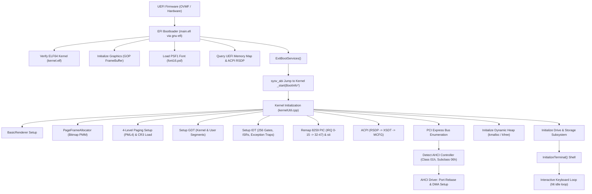
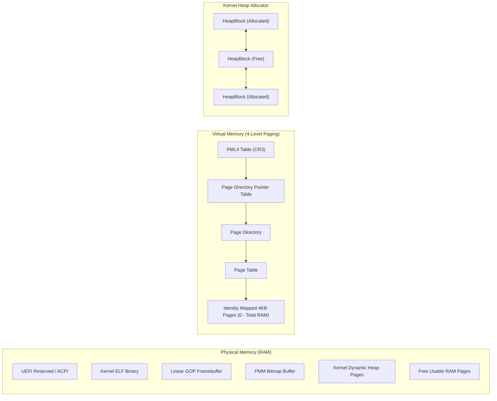
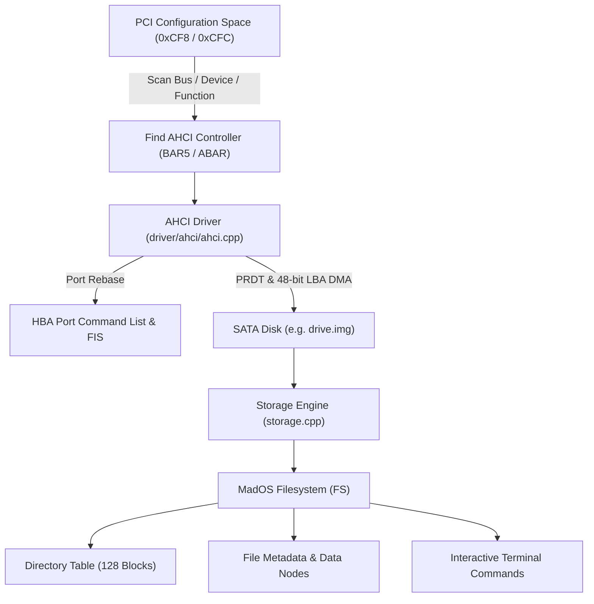

# MadOS

An x86_64 UEFI hobby operating system written from scratch in C++ and Assembly (NASM), featuring a pure 64-bit long-mode kernel, UEFI GOP graphics rasterization, 4-level paging memory manager, dynamic kernel heap, comprehensive interrupt & exception architecture, PCI/ACPI hardware enumeration, an AHCI SATA storage driver with DMA, a custom linked-block filesystem, and an interactive shell terminal.

---

## Table of Contents

- [Overview](#overview)
- [System Architecture](#system-architecture)
  - [Boot Pipeline & Execution Flow](#boot-pipeline--execution-flow)
  - [Memory Architecture](#memory-architecture)
  - [Hardware & Storage Stack](#hardware--storage-stack)
- [Key Features](#key-features)
- [Subsystem Implementations](#subsystem-implementations)
  - [1. UEFI Bootloader (`gnu-efi`)](#1-uefi-bootloader-gnu-efi)
  - [2. Graphics Subsystem & Console Renderer](#2-graphics-subsystem--console-renderer)
  - [3. Physical Memory Manager (PMM)](#3-physical-memory-manager-pmm)
  - [4. Virtual Memory & 4-Level Paging (VMM)](#4-virtual-memory--4-level-paging-vmm)
  - [5. Dynamic Kernel Heap Allocator](#5-dynamic-kernel-heap-allocator)
  - [6. Vectorized Memory Routines (`memset`)](#6-vectorized-memory-routines-memset)
  - [7. Global Descriptor Table (GDT)](#7-global-descriptor-table-gdt)
  - [8. Interrupts, Exceptions & PIC](#8-interrupts-exceptions--pic)
  - [9. Hardware Timer (PIT) & Delays](#9-hardware-timer-pit--delays)
  - [10. PS/2 Keyboard Driver & Scancode Translation](#10-ps2-keyboard-driver--scancode-translation)
  - [11. ACPI & PCI Express Bus Enumeration](#11-acpi--pci-express-bus-enumeration)
  - [12. AHCI SATA Storage Driver (DMA)](#12-ahci-sata-storage-driver-dma)
  - [13. Custom Linked-Block Filesystem (`FS`)](#13-custom-linked-block-filesystem-fs)
  - [14. Interactive Terminal Shell](#14-interactive-terminal-shell)
- [Repository Structure](#repository-structure)
- [Shell Command Reference](#shell-command-reference)
- [Prerequisites & Toolchain Setup](#prerequisites--toolchain-setup)
- [Building the OS](#building-the-os)
  - [1. Compile the Kernel](#1-compile-the-kernel)
  - [2. Build the UEFI Bootloader (Optional)](#2-build-the-uefi-bootloader-optional)
  - [3. Generate Bootable Disk Image](#3-generate-bootable-disk-image)
- [Running on Emulators (QEMU)](#running-on-emulators-qemu)
  - [Quick Run](#quick-run)
  - [QEMU Command Breakdown](#qemu-command-breakdown)
  - [Running on Windows](#running-on-windows)
- [Running on Real Hardware](#running-on-real-hardware)
  - [USB Drive Preparation](#usb-drive-preparation)
  - [UEFI BIOS Configuration](#uefi-bios-configuration)
- [Troubleshooting](#troubleshooting)
- [Roadmap](#roadmap)
- [License & Acknowledgments](#license--acknowledgments)

---

## Overview

**MadOS** is an experimental, bare-metal operating system built for modern x86_64 machines. Unlike legacy operating systems that rely on 16-bit BIOS interrupts, Real Mode, and Protected Mode transition stages, MadOS targets modern **UEFI firmware** (Unified Extensible Firmware Interface) from the very first instruction.

### Why UEFI?
- Boots straight into **64-bit Long Mode**, bypassing the archaic Real Mode -> Protected Mode -> Long Mode sequence.
- Leverages the **Graphics Output Protocol (GOP)** for high-resolution linear framebuffer rendering without VESA BIOS extensions.
- Obtains precise physical memory maps directly from firmware tables.
- Seamlessly discovers ACPI Root System Description Pointer (RSDP) tables to unlock modern hardware enumeration.

---

## System Architecture

### Boot Pipeline & Execution Flow



### Memory Architecture



### Hardware & Storage Stack



---

## Key Features

- **64-bit Long Mode Kernel**: Built with freestanding GCC and NASM, strictly adhering to System V AMD64 ABI.
- **Pure UEFI Booting**: Loaded via an EFI PE executable (`main.efi`) built using `gnu-efi`.
- **Graphical Console Engine**:
  - High-resolution linear 32-bit RGB framebuffer rasterization via GOP.
  - PC Screen Font 1 (PSF1, 16px) bitmap glyph renderer.
  - Formatted text output, ANSI-style color themes, cursor tracking, and backspace erase.
- **Physical Memory Manager (PMM)**:
  - Dynamic page-frame bitmap allocator tracking 4KB pages.
  - Automatically parses UEFI memory descriptors to protect firmware and reserved regions.
- **Virtual Memory Manager (VMM)**:
  - 4-level paging (`PML4` -> `PDPT` -> `PD` -> `PT`).
  - Identity mapping across physical RAM and memory-mapped I/O (MMIO) devices.
  - Assembly paging activator loading `CR3`, enabling `CR4.PAE`, and enforcing `CR0.WP` + `CR0.PG`.
- **Dynamic Kernel Heap (`kmalloc` / `kfree`)**:
  - Doubly-linked first-fit heap allocator with 16-byte alignment.
  - Dynamic block splitting and bidirectional block coalescing.
  - Automatic heap expansion requesting backing frames from the PMM.
- **Vector-Accelerated Memory Operations**:
  - High-speed `memset` utilizing GCC vector SIMD extensions (`char8`, `char16`, `char32`, `char32a`) and unrolled loops.
- **Robust CPU Core & Interrupts**:
  - 64-bit Global Descriptor Table (GDT) with code and data segments for Ring 0 and Ring 3.
  - Interrupt Descriptor Table (IDT) with 256 gates (`0x8E` Interrupt Gate).
  - Exception dispatcher for all 32 x86 CPU faults (#DE, #DF, #GP, #PF, etc.) with register snapshots.
  - Dual 8259 PIC remapping (master: `0x20`, slave: `0x28`) avoiding CPU exception collisions.
  - PIT hardware timer (IRQ0) for tick counting and millisecond delays.
  - PS/2 keyboard driver (IRQ1) with scancode-to-ASCII translation and Shift modifier handling.
- **Hardware Bus & Storage Drivers**:
  - ACPI 2.0 parser: verifies RSDP checksums and locates the PCI Express MCFG table.
  - PCI Bus Scanner: traverses 256 buses, 32 devices, and 8 functions via `0xCF8`/`0xCFC` ports, resolving vendor and device descriptors.
  - AHCI SATA Driver: interacts with SATA controllers via Memory-Mapped I/O (ABAR), configuring command lists, received FIS buffers, PRDTs, and executing 48-bit LBA DMA read/write commands (`READ_DMA_EX`, `WRITE_DMA_EX`, `IDENTIFY`).
- **Custom Filesystem (`FS`)**:
  - Sector allocation bitmap tracking disk occupancy.
  - Directory table managing file metadata entries.
  - Linked block system supporting file creation, listing, reading, and writing.
- **Interactive Shell Terminal**:
  - Real-time command-line interface (`Shell:/ > `) with memory diagnostics, disk mounting, drive formatting, and file I/O commands.

---

## Subsystem Implementations

### 1. UEFI Bootloader (`gnu-efi`)
Located in [`gnu-efi/bootloader/main.c`](gnu-efi/bootloader/main.c), the bootloader acts as the bridge between UEFI firmware and the kernel:
1. **Locate and Read Kernel**: Loads `kernel.elf` from the boot FAT filesystem using `EFI_SIMPLE_FILE_SYSTEM_PROTOCOL`.
2. **Validate ELF64**: Verifies ELF magic numbers (`0x7F 'E' 'L' 'F'`), architecture (`EM_X86_64`), class (`ELFCLASS64`), and data format (`ELFDATA2LSB`).
3. **Load Segments**: Parses Program Headers (`Elf64_Phdr`). For every `PT_LOAD` segment, allocates physical pages with `AllocatePages` and copies segment data into memory.
4. **Acquire Graphics**: Calls `InitializeGOP()` via `EFI_GRAPHICS_OUTPUT_PROTOCOL` to extract the framebuffer physical base, size, resolution, and scanline pitch.
5. **Load PSF1 Font**: Reads `font16.psf`, validates header magic (`0x36 0x04`), and buffers glyph bit patterns.
6. **Query Memory Map & ACPI**: Requests the firmware memory map (`GetMemoryMap`) and scans `EFI_CONFIGURATION_TABLE` for `ACPI_20_TABLE_GUID` to capture the Root System Description Pointer (RSDP).
7. **Handoff**: Calls `ExitBootServices()`, constructs a `BootInfo` structure, and transfers control to the kernel entry point via `sysv_abi`:
   ```c
   void (*KernelStart)(BootInfo*) = ((__attribute__((sysv_abi)) void (*)(BootInfo*)) header.e_entry);
   KernelStart(&bootInfo);
   ```

### 2. Graphics Subsystem & Console Renderer
Located in [`kernel/src/BasicRenderer.cpp`](kernel/src/BasicRenderer.cpp) and [`kernel/src/FrameBuffer.h`](kernel/src/FrameBuffer.h):
- Uses 32-bit linear framebuffer memory directly mapped from GOP.
- `PutChar(char ch)`: Decodes 8x16 bitmap glyphs from `PSF1_FONT`, testing bit masks `(0b10000000 >> bit)` and plotting corresponding pixels.
- `RemoveChar()`: Supports in-place backspacing by repainting the 8x16 glyph bounding box with the background color (`0x272829`).
- `Clear(uint32_t color)`: Sweeps every scanline to reset the entire display.
- Color themes: Yellow (`0xCECE5A`) shell prompts, cyan (`0x73BBC9`) indicators, gold (`0xFEC260`) headers, and red/white panic screens.
- **Kernel Panic** ([`kernel/src/panic.cpp`](kernel/src/panic.cpp)): Clears the screen to white, prints `"Damn! We broke :("`, displays the panic reason, and locks the CPU.

### 3. Physical Memory Manager (PMM)
Located in [`kernel/src/paging/PageFrameAllocator.cpp`](kernel/src/paging/PageFrameAllocator.cpp):
- Utilizes a bit array ([`kernel/src/Bitmap.cpp`](kernel/src/Bitmap.cpp)) where 1 bit represents one 4096-byte physical page.
- Finds the largest contiguous free memory segment from UEFI descriptors to host the allocation bitmap itself.
- Classifies pages into **Free**, **Reserved** (UEFI runtime/ACPI/firmware memory), and **Allocated** (kernel executable, framebuffer, and heap).
- Provides `RequestPage()`, `AllocatePages(addr, count)`, `FreePages(addr, count)`, and diagnostics: `GetFreeRAM()`, `GetUsedRAM()`, `GetReservedRAM()`.

### 4. Virtual Memory & 4-Level Paging (VMM)
Located in [`kernel/src/paging/`](kernel/src/paging/):
- **PageMapIndexer** ([`PageMapIndexer.cpp`](kernel/src/paging/PageMapIndexer.cpp)): Deconstructs any 64-bit virtual address into four 9-bit indices:
  - `PML4_i` (bits 39–47)
  - `PDP_i`  (bits 30–38)
  - `PD_i`   (bits 21–29)
  - `PT_i`   (bits 12–20)
- **PageTableManager** ([`PageTableManager.cpp`](kernel/src/paging/PageTableManager.cpp)): Recursively walks or creates page tables down to the leaf page directory entry, setting the `Present` and `ReadWrite` flags.
- **Hardware Activation** ([`enablePaging.asm`](kernel/src/paging/enablePaging.asm)):
  ```nasm
  enablePaging:
    mov rax, rdi      ; Load PML4 physical address
    mov cr3, rax      ; Set CR3
    mov rax, cr4
    or rax, 1 << 5    ; Enable PAE (bit 5)
    mov cr4, rax
    mov rax, cr0
    or rax, 1 << 31   ; Enable Paging (PG, bit 31)
    or rax, 1 << 16   ; Enable Write Protect (WP, bit 16)
    mov cr0, rax
    retq
  ```

### 5. Dynamic Kernel Heap Allocator
Located in [`kernel/src/mem/heap.cpp`](kernel/src/mem/heap.cpp):
- Manages dynamic kernel allocations via a doubly-linked list of `HeapBlock` headers:
  ```cpp
  struct HeapBlock {
      uint32_t size;
      bool free;
      struct HeapBlock* prev;
      struct HeapBlock* next;
  };
  ```
- All memory allocations (`kmalloc`) are aligned to 16-byte boundaries.
- Uses **First-Fit search**; splits large free blocks when the remaining space allows.
- `kfree(ptr)` marks the block free and calls `mergeBlock()` to coalesce adjacent free blocks bidirectionally, preventing heap fragmentation.
- When no free block can accommodate the requested size, `Expand()` dynamically allocates new 4KB physical pages and links them into the heap list.

### 6. Vectorized Memory Routines (`memset`)
Located in [`kernel/src/mem/mem.cpp`](kernel/src/mem/mem.cpp):
- Provides high-performance memory writes using GCC native vector extensions (`char8`, `char16`, `char32`, `char32a`).
- Adapts strategy based on buffer size:
  - `< 32 bytes`: `small_memset` using 64-bit/32-bit register stores.
  - `32 to 160 bytes`: 32-byte vector writes.
  - `> 160 bytes`: `huge_memset` with unrolled 160-byte SIMD blocks (5 × 32-byte stores per loop cycle) and memory alignment.

### 7. Global Descriptor Table (GDT)
Located in [`kernel/src/GDT/`](kernel/src/GDT/):
- Sets up a 64-bit flat segmentation table:
  - `0x00`: Null Descriptor
  - `0x08`: Kernel Code Segment (64-bit, Ring 0, executable, readable)
  - `0x10`: Kernel Data Segment (Ring 0, read/write)
  - `0x18`: User Code Segment (Ring 3)
  - `0x20`: User Data Segment (Ring 3)
- `setGDT` ([`GDT.asm`](kernel/src/GDT/GDT.asm)): Executes `lgdt [rdi]`, performs a far return (`retfq`) with `0x08` to reload the `CS` register, and resets data segment registers (`DS`, `ES`, `FS`, `GS`, `SS`) with selector `0x10`.

### 8. Interrupts, Exceptions & PIC
Located in [`kernel/src/interrupts/`](kernel/src/interrupts/):
- **IDT**: 256 gates initialized with selector `0x08` and attribute `0x8E` (Interrupt Gate).
- **Assembly Stubs** ([`IDT.asm`](kernel/src/interrupts/IDT.asm)): A unified macro saves all general-purpose registers (`pushall`), invokes `isr_handler(registers_t*)`, restores registers (`popall`), cleans the stack, and returns via `iretq`.
- **CPU Exception Traps**: Vectors 0–31 intercept all CPU faults (#DE, #BP, #DF, #GP, #PF, etc.). On a fault, `isr_handler` displays the fault description and dumps register states (`rax`, `rbx`, `rcx`, `rdx`, `rsi`, `rdi`, `rip`, `rsp`, `cs`, `ss`) before halting.
- **PIC Remapping** ([`pic.asm`](kernel/src/interrupts/pic.asm)): Reprograms the 8259 master PIC to vector offset `0x20` (32) and the slave PIC to `0x28` (40). Issues End-Of-Interrupt (`EOI = 0x20`) commands to ports `0x20` and `0xA0` after servicing hardware IRQs.

### 9. Hardware Timer (PIT) & Delays
Located in [`kernel/src/timer/pit.cpp`](kernel/src/timer/pit.cpp):
- Connected to IRQ0 (Interrupt Vector 32).
- Increments an unsigned 64-bit counter `ticks` on every interrupt.
- Exposes `sleep(uint16_t interval)` for precise synchronous delays.

### 10. PS/2 Keyboard Driver & Scancode Translation
Located in [`kernel/src/userinput/`](kernel/src/userinput/):
- Hooked to IRQ1 (Interrupt Vector 33). Reads keyboard scancodes from I/O port `0x60`.
- Supports Scancode Set 1 translation:
  - Shift Key press (`0x2A`) and release (`0xAA`) tracking for uppercase characters.
  - Tab expansion (`0x0F` -> 4 spaces).
  - Backspace (`0x0E`) updating input buffer and calling `GlobalRenderer->RemoveChar()`.
  - Enter key (`0x1C`) triggering `EnterHandler()`, which hands the buffer off to `ExecutePrompt()`.

### 11. ACPI & PCI Express Bus Enumeration
Located in [`kernel/src/system/acpi/`](kernel/src/system/acpi/) and [`kernel/src/system/pci/`](kernel/src/system/pci/):
- **ACPI**: Verifies RSDP checksum, resolves the 64-bit XSDT address, walks table headers, and locates the `MCFG` table for PCIe discovery.
- **PCI Scanner**: Interrogates PCI configuration space using legacy ports `0xCF8` (Address) and `0xCFC` (Data):
  - Traverses 256 buses, 32 devices, and 8 functions.
  - Reads Vendor ID, Device ID, Class Code, Subclass, and Program Interface.
  - Translates IDs to human-readable strings (Intel, AMD, Dell, VGA, SATA, Host Bridge, etc.).
  - Filters for SATA AHCI Controllers (`Class == 0x01`, `Subclass == 0x06`, `ProgIF == 0x01`) and retrieves the AHCI Base Address Register (`BAR5` / `ABAR`).

### 12. AHCI SATA Storage Driver (DMA)
Located in [`kernel/src/driver/ahci/ahci.cpp`](kernel/src/driver/ahci/ahci.cpp):
- Interacts with SATA controllers over Memory-Mapped I/O via the HBA memory structure (`HBAMem`).
- **Port Rebase (`PortRebase`)**:
  - Stops port command engines (`HBA_PxCMD_ST`, `HBA_PxCMD_FRE`).
  - Allocates 4KB-aligned physical frames for Command List Base (`clb`) and Received FIS Base (`fb`).
  - Sets up 32 Command Header descriptors, each with its own Command Table (`ctba`) and Physical Region Descriptor Tables (PRDTs).
  - Re-enables the command engine.
- **DMA Transfers**:
  - `Read()`: Dispatches `ATA_CMD_READ_DMA_EX` (Command 0x25) via a Host-to-Device Register FIS (`FIS_TYPE_REG_H2D`) with 48-bit LBA addressing.
  - `Write()`: Dispatches `ATA_CMD_WRITE_DMA_EX` (Command 0x35) with DMA buffers mapped through PRDT entries.
- **Drive Identification**: Sends `ATA_CMD_IDENTIFY` (0xEC) to retrieve model strings and sector count (`ReadDiskSize()`).

### 13. Custom Linked-Block Filesystem (`FS`)
Located in [`kernel/src/system/storage/storage.cpp`](kernel/src/system/storage/storage.cpp):
- Provides basic disk storage functionality on the mounted AHCI SATA port:
  - **Directory Table (`DirectoryTableEntry`)**: Stored at sector `(SectorCount / 512) + 1`, managing up to 128 block addresses.
  - **File Metadata (`FileMetaData`)**: Stores the file name, `FirstNode`, and `LastNode` sector pointers.
  - **Sector Allocation Bitmap**: Tracks free/used 512-byte disk sectors.
  - **Operations**:
    - `FormatDrive()`: Clears sector allocation maps, writes a fresh Directory Table, and initializes a default `"system"` file.
    - `fs.List()`: Iterates directory table blocks and returns file names.
    - `fs.Open(name)`: Searches matching metadata and reads the file content into memory.
    - `fs.WriteBuffer(name, buf)`: Writes data blocks to the disk sector pointed to by the file node.

### 14. Interactive Terminal Shell
Located in [`kernel/src/processes/terminal/interface.cpp`](kernel/src/processes/terminal/interface.cpp):
- An asynchronous shell rendered directly into the frame buffer.
- Features a custom prompt: `Shell:/ > `
- Executes commands on Enter without halting interrupt processing.

---

## Repository Structure

```
mados/
├── README.md                      # Comprehensive OS documentation (this file)
├── OVMFbin/                       # Pre-compiled UEFI firmware for QEMU
│   ├── OVMF_CODE-pure-efi.fd      # OVMF firmware code
│   └── OVMF_VARS-pure-efi.fd      # OVMF firmware NVRAM variables
├── gnu-efi/                       # GNU-EFI library & bootloader build tree
│   ├── bootloader/
│   │   ├── main.c                 # UEFI bootloader implementation
│   │   └── Makefile               # Bootloader Makefile
│   ├── inc/                       # EFI header files
│   ├── lib/                       # EFI runtime support routines
│   └── x86_64/bootloader/
│       └── main.efi               # Compiled x86_64 UEFI boot application
└── kernel/                        # MadOS Kernel Source Tree
    ├── Makefile                   # Kernel build, image packaging, and QEMU runner
    ├── kernel.ld                  # Linker script (64-bit ELF, aligned sections)
    ├── startup.nsh                # UEFI shell startup script
    ├── run.bat / run2.bat         # Windows QEMU launch scripts
    ├── bin/                       # Build outputs & disk images
    │   ├── font16.psf             # PSF1 8x16 console bitmap font
    │   ├── kernel.elf             # Compiled 64-bit ELF kernel
    │   ├── MadOS.img              # Bootable UEFI FAT32 disk image
    │   └── drive.img              # Secondary SATA drive image for storage testing
    └── src/                       # Kernel source code
        ├── kernel.cpp             # Kernel entry point (_start)
        ├── kernelUtil.h / .cpp    # Subsystem orchestrator (InitializeKernel)
        ├── FrameBuffer.h          # Framebuffer layout structure
        ├── font.h                 # PSF1 font header structures
        ├── BasicRenderer.h / .cpp # Text console rasterizer & display engine
        ├── Bitmap.h / .cpp        # Bit array utility for memory management
        ├── efiMemory.h / .cpp     # EFI memory descriptor definitions
        ├── math.h                 # Coordinate and 2D Point definitions
        ├── cstr.h / .cpp          # String conversions (to_string, to_hstring, atoi)
        ├── utils.h / .cpp         # Formatted memory size printers
        ├── panic.h / .cpp         # Kernel panic screen handler
        ├── IO.h / .cpp            # x86 I/O port assembly intrinsics (inb, outb, etc.)
        ├── GDT/                   # Global Descriptor Table
        │   ├── GDT.h / .cpp       # Segment descriptor structures & definitions
        │   └── GDT.asm            # lgdt & far-return segment reload routine
        ├── mem/                   # Memory operations & Heap
        │   ├── mem.h / .cpp       # Vector-optimized SIMD memset & memory sizing
        │   └── heap.h / .cpp      # Doubly-linked list kmalloc & kfree
        ├── paging/                # 4-Level Paging Subsystem
        │   ├── paging.h / .cpp    # Page directory entries & bit flags
        │   ├── PageMapIndexer.h/.cpp # 64-bit virtual address index extractor
        │   ├── PageTableManager.h/.cpp # Page table mapper & manager
        │   ├── PageFrameAllocator.h/.cpp # Bitmap-based Physical Memory Manager
        │   └── enablePaging.asm   # Assembly CR3 loader & paging activator
        ├── interrupts/            # Interrupt & Exception Architecture
        │   ├── IDT.h / .cpp       # 256 IDT gate initializers & lidtq
        │   ├── IDT.asm            # Assembly ISR stubs (pushall / popall / iretq)
        │   ├── IST.h / .cpp       # Interrupt Service Table & isr_handler dispatcher
        │   └── pic.h / pic.asm    # 8259 PIC remapping routine
        ├── timer/                 # Hardware Timer
        │   └── pit.h / .cpp       # PIT IRQ0 handler & sleep() utility
        ├── userinput/             # Keyboard & Input System
        │   ├── keyboard.h / .cpp  # PS/2 scancode decoder & shift state tracker
        │   └── keyboardEvents.cpp # Keyboard enter dispatching to the shell
        ├── system/                # Hardware Discovery & Filesystem
        │   ├── acpi/              # ACPI RSDP, XSDT & MCFG parser
        │   │   └── acpi.h / .cpp
        │   ├── pci/               # PCI configuration space scanner
        │   │   ├── pci.h / .cpp
        │   │   └── pciDevicesInfo.cpp # PCI vendor/device ID string tables
        │   └── storage/           # MadOS custom filesystem engine
        │       └── storage.h / .cpp
        ├── driver/                # Hardware Drivers
        │   └── ahci/              # AHCI SATA driver with 48-bit LBA DMA
        │       └── ahci.h / .cpp
        └── processes/terminal/    # Interactive Shell Process
            └── interface.h / .cpp # Terminal prompt parser & command execution
```

---

## Shell Command Reference

When MadOS boots, you are greeted with the interactive terminal prompt:

```
Shell:/ > 
```

The shell provides the following built-in commands:

| Command | Arguments | Description | Example |
| :--- | :--- | :--- | :--- |
| `memory info` | *None* | Displays physical RAM breakdown: Used RAM, Reserved RAM, and Free RAM with auto-scaled units (B, KB, MB, GB). | `memory info` |
| `drives list` | *None* | Scans AHCI ports and prints all connected SATA and SATAPI drives with their port index. | `drives list` |
| `drives mount` | `<port_number>` | Mounts the specified AHCI SATA port for filesystem operations. | `drives mount 1` |
| `drives format`| *None* | Formats the currently mounted SATA drive with a new MadOS filesystem and directory table. | `drives format` |
| `drives size`  | *None* | Queries the mounted drive via `ATA_CMD_IDENTIFY` and prints its total capacity. | `drives size` |
| `fs list`      | *None* | Lists all files present in the directory table of the mounted drive. | `fs list` |
| `fs open`      | `<filename>` | Reads and displays the text content of the specified file. | `fs open system` |
| `fs write`     | `<filename>` | Writes data to the target file on the mounted drive. | `fs write system` |

---

## Prerequisites & Toolchain Setup

To build and run MadOS, you need standard x86_64 development tools, `nasm`, `mtools` (for creating EFI FAT images), and `qemu`.

### Ubuntu / Debian
```bash
sudo apt update
sudo apt install -y build-essential gcc g++ nasm ld mtools qemu-system-x86
```

### Arch Linux
```bash
sudo pacman -S base-devel gcc nasm mtools qemu-system-x86
```

### Fedora
```bash
sudo dnf groupinstall "Development Tools"
sudo dnf install -y nasm mtools qemu-system-x86-core
```

---

## Building the OS

The build process involves compiling the kernel C++ and assembly files, linking them into an ELF64 binary, and assembling a bootable FAT32 disk image containing the UEFI bootloader and kernel assets.

### 1. Compile the Kernel
Navigate to the `kernel/` directory and compile:

```bash
cd kernel
make kernel
```
This performs:
- Freestanding compilation of all C++ source files (`-ffreestanding -fshort-wchar -mno-red-zone`).
- Assembly of NASM routines into 64-bit ELF objects (`nasm -f elf64`).
- Linking into `bin/kernel.elf` using `kernel.ld` (`ld -static -Bsymbolic -nostdlib`).

### 2. Build the UEFI Bootloader (Optional)
The pre-compiled bootloader binary `main.efi` is already included at `gnu-efi/x86_64/bootloader/main.efi`. If you modify `gnu-efi/bootloader/main.c`, recompile it with:

```bash
cd gnu-efi
make
```

### 3. Generate Bootable Disk Image
Build the UEFI disk image:

```bash
cd kernel
make buildimg
```
This executes the following disk image generation pipeline:
1. Creates a zeroed 48 MB raw disk image:
   ```bash
   dd if=/dev/zero of=bin/MadOS.img bs=512 count=93750
   ```
2. Formats the image with a FAT filesystem via `mformat`:
   ```bash
   mformat -i bin/MadOS.img ::
   ```
3. Creates the standard UEFI directory structure:
   ```bash
   mmd -i bin/MadOS.img ::/EFI
   mmd -i bin/MadOS.img ::/EFI/BOOT
   ```
4. Copies the bootloader, kernel, startup script, and font into the image:
   ```bash
   mcopy -i bin/MadOS.img ../gnu-efi/x86_64/bootloader/main.efi ::/EFI/BOOT
   mcopy -i bin/MadOS.img startup.nsh ::
   mcopy -i bin/MadOS.img bin/kernel.elf ::
   mcopy -i bin/MadOS.img bin/font16.psf ::
   ```

*(Optional)* If you need to create a fresh secondary storage drive for testing filesystem operations:
```bash
qemu-img create -f raw bin/drive.img 100M
```

---

## Running on Emulators (QEMU)

### Quick Run
From the `kernel/` directory, launch the operating system with:

```bash
cd kernel
make run
```

### QEMU Command Breakdown
The `make run` target runs QEMU with the exact configuration required for UEFI and SATA emulation:

```bash
qemu-system-x86_64 \
    -machine q35 \
    -drive file=bin/MadOS.img \
    -drive file=bin/drive.img \
    -m 256M \
    -cpu qemu64 \
    -drive if=pflash,format=raw,unit=0,file="../OVMFbin/OVMF_CODE-pure-efi.fd",readonly=on \
    -drive if=pflash,format=raw,unit=1,file="../OVMFbin/OVMF_VARS-pure-efi.fd" \
    -net none \
    -D ./qemu.log
```

**Flag Explanations:**
- `-machine q35`: Emulates Intel's modern ICH9/Q35 chipset with native PCI Express and AHCI SATA controllers (required for the AHCI storage driver).
- `-drive file=bin/MadOS.img`: Primary boot disk containing the UEFI bootloader and kernel.
- `-drive file=bin/drive.img`: Secondary raw SATA drive on port 1 used for testing filesystem formatting, file creation, and reads/writes.
- `-m 256M`: Allocates 256 Megabytes of RAM to the virtual machine.
- `-cpu qemu64`: Standard 64-bit x86 processor emulation.
- `-drive if=pflash,...,file="../OVMFbin/OVMF_CODE-pure-efi.fd"`: Loads the pure UEFI firmware code provided in the repository.
- `-drive if=pflash,...,file="../OVMFbin/OVMF_VARS-pure-efi.fd"`: Loads the UEFI NVRAM variable store.
- `-net none`: Disables networking hardware to focus on core OS subsystems.
- `-D ./qemu.log`: Redirects QEMU debugging output to `qemu.log`.

### Running on Windows
If developing on Windows without WSL:
1. Ensure `qemu-system-x86_64` is in your Windows `PATH`.
2. Double-click or run [`kernel/run.bat`](kernel/run.bat) or [`kernel/run2.bat`](kernel/run2.bat) from a Windows Command Prompt.

---

## Running on Real Hardware

You can run MadOS on a physical x86_64 PC supporting UEFI boot!

### USB Drive Preparation

1. **Format a USB drive** with a **GPT** partition table and format the partition as **FAT32**.
2. Create the EFI boot directory structure on the USB root:
   ```
   USB_ROOT/
   ├── startup.nsh
   ├── kernel.elf
   ├── font16.psf
   └── EFI/
       └── BOOT/
           └── BOOTX64.EFI
   ```
3. Copy `gnu-efi/x86_64/bootloader/main.efi` to `EFI/BOOT/BOOTX64.EFI` on the USB drive.
4. Copy `kernel/bin/kernel.elf`, `kernel/bin/font16.psf`, and `kernel/startup.nsh` to the root directory of the USB drive.

### UEFI BIOS Configuration

1. Insert the USB drive into your PC.
2. Enter your motherboard's UEFI BIOS Setup (usually via `F2`, `F11`, `F12`, or `Del` at startup).
3. **Disable Secure Boot**: MadOS does not have a Microsoft-signed UEFI key.
4. **Enable UEFI Boot Mode** (Disable legacy CSM / BIOS mode).
5. Ensure SATA mode is set to **AHCI** (not IDE or RAID).
6. Select your USB drive from the UEFI boot override menu.
7. The UEFI shell will execute `startup.nsh`, load `main.efi`, transition to 64-bit mode, and start MadOS!

---

## Troubleshooting

### QEMU displays a black screen or fails to find the bootloader
- Verify that the OVMF firmware paths exist in `OVMFbin/`.
- Ensure the image has the correct layout: `::/EFI/BOOT/main.efi` and `::/startup.nsh`.
- Check `kernel/qemu.log` for any firmware error dumps.

### `mformat: command not found` or `mcopy: command not found`
- The `mtools` utility is missing. Install it using:
  ```bash
  sudo apt install mtools
  ```

### Storage commands report `"No Drive is Mounted"`
- Run `drives list` to see available AHCI ports.
- Run `drives mount 1` to mount the secondary drive.
- Format the drive using `drives format` before attempting filesystem operations (`fs list`, `fs open`, `fs write`).

### General Protection Fault (`#GP`) or Page Fault (`#PF`)
- An invalid memory dereference was attempted. MadOS will capture the exception in `isr_handler` and display the saved registers (`rip`, `rsp`, `rax`, etc.) along with the fault name to assist with debugging.

---

## Roadmap

- [x] UEFI Bootloader with ELF64 Loading (`gnu-efi`)
- [x] Linear Framebuffer Console (`GOP` & `PSF1`)
- [x] Physical Page Allocator (Bitmap PMM)
- [x] 4-Level Virtual Memory Paging (PML4 / CR3)
- [x] Dynamic Kernel Heap (`kmalloc` / `kfree`)
- [x] 64-bit GDT & IDT with 256 Interrupt Gates
- [x] 8259 PIC Remap, PIT Timer & PS/2 Keyboard Driver
- [x] ACPI RSDP/MCFG & PCI Express Bus Enumeration
- [x] AHCI SATA Controller Driver with 48-bit LBA DMA
- [x] Custom Linked-Block Filesystem & Disk Formatting
- [x] Interactive Terminal Shell
- [ ] Preemptive Multitasking & Round-Robin Scheduler
- [ ] Ring 3 User Space Separation & `syscall` / `sysret` Interface
- [ ] Virtual Filesystem (VFS) Abstraction Layer
- [ ] PS/2 Mouse Driver & Window Compositor
- [ ] TCP/IP Network Stack (Intel E1000 / RTL8139)

---

## License & Acknowledgments

Developed by **[MadCoderme](https://github.com/MadCoderme)**.

Special thanks to:
- The **[OSDev Wiki](https://wiki.osdev.org/)** community for documentation on x86_64, UEFI, GDT/IDT, and AHCI.
- The **[gnu-efi](https://sourceforge.net/projects/gnu-efi/)** project for UEFI development libraries.
- The **Intel 64 and IA-32 Architectures Software Developer Manuals**.
